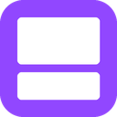
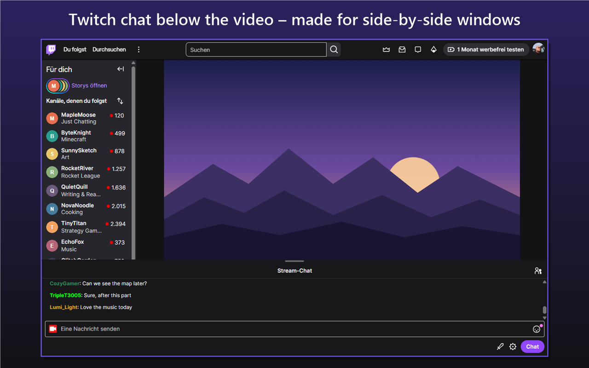
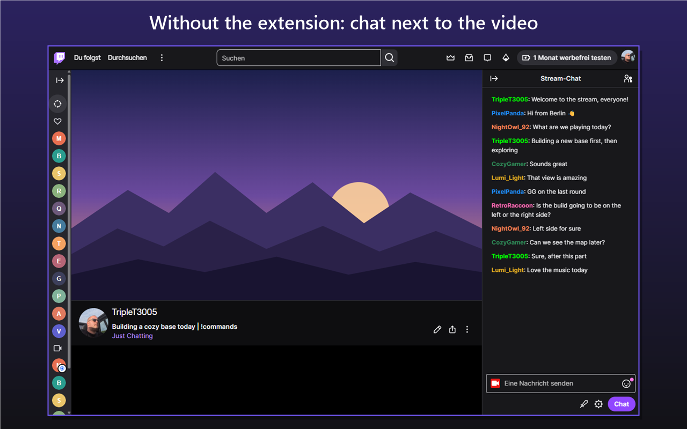
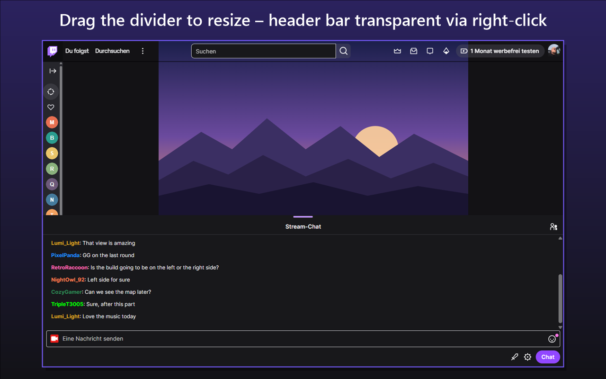
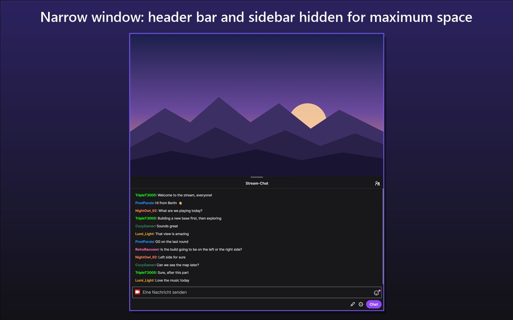
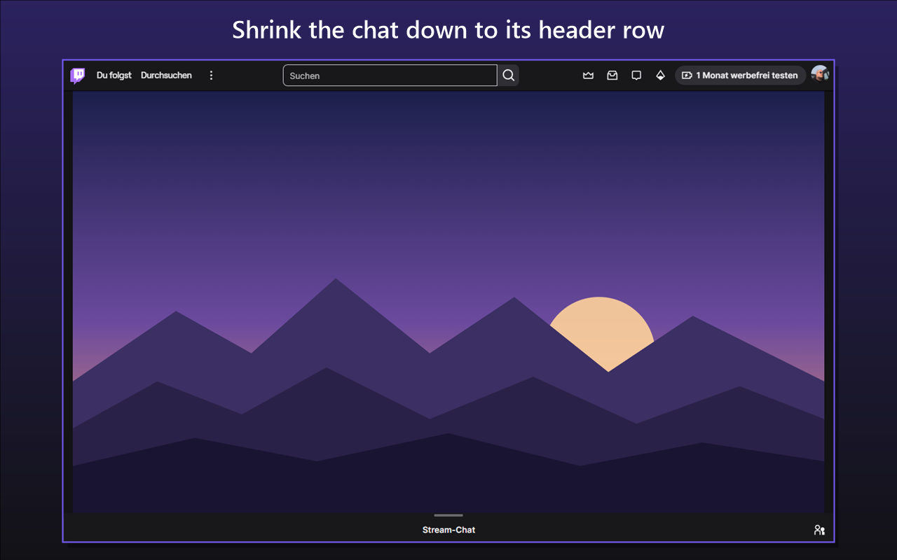

# Chat Below for Twitch

[English](#english) · [Deutsch](#deutsch) · [Screenshots](#screenshots)

## English

Browser extension for Chrome and Edge that moves the Twitch chat below the video with one click.
Useful when the monitor is split into two or three windows side by side.
Website: https://ckass.de/chat-below-for-twitch/

> Not affiliated with or endorsed by Twitch. Twitch is a trademark of Twitch Interactive, Inc.

### Features
- Toggle via the chat button in the video's control bar (next to settings and fullscreen) or via the extension icon in the browser toolbar
- Optional keyboard shortcut, configurable at `chrome://extensions/shortcuts` (Edge: `edge://extensions/shortcuts`)
- The video uses the full window width, the chat fills the space below it (at least 150 px)
- A running hype train is shown compactly in the chat header row
- Right-click the extension icon to hide the header bar or make it transparent, and to hide the left sidebar (applies while the chat is below the video)
- Drag the line between video and chat to change the split, down to just the chat header; double-click resets it
- The setting is remembered for all Twitch tabs; with browser sync enabled it also applies on your other computers
- Available in English and German, depending on the browser language

### Privacy
The extension only changes how the Twitch page is laid out. It does not read or send any data, has no access to your Twitch account and makes no external requests.
It only uses the permissions `storage` (to remember its settings) and `contextMenus` (for the right-click menu of its icon). Full privacy policy: https://ckass.de/chat-below-for-twitch/#privacy

### Install
- **Chrome:** [Chrome Web Store](https://chromewebstore.google.com/detail/chat-below-for-twitch/jfdcnglmpjdiofdlapohkchhhmkjffog)
- **Edge:** Edge Add-ons (coming soon)

Manual install from ZIP:
1. Download the latest ZIP from [Releases](../../releases) and extract it
2. Open `chrome://extensions` (Edge: `edge://extensions`)
3. Enable "Developer mode"
4. Click "Load unpacked" and select the extracted folder

### License
[MIT](LICENSE)

## Deutsch

Browser-Erweiterung für Chrome und Edge, die den Twitch-Chat per Klick unter das Video verschiebt.
Praktisch, wenn der Monitor in zwei oder drei Fenster nebeneinander aufgeteilt ist.
Website: https://ckass.de/chat-below-for-twitch/

> Nicht mit Twitch verbunden und nicht von Twitch unterstützt. Twitch ist eine Marke von Twitch Interactive, Inc.

### Funktionen
- Umschalten über den Chat-Button in der Steuerleiste des Videos (neben Einstellungen und Vollbild) oder über das Erweiterungssymbol oben in der Browserleiste
- Optionales Tastenkürzel, einstellbar unter `chrome://extensions/shortcuts` (Edge: `edge://extensions/shortcuts`)
- Das Video nutzt die volle Fensterbreite, der Chat füllt den Platz darunter (mindestens 150 px)
- Ein laufender Hypetrain wird kompakt in der Kopfzeile des Chats angezeigt
- Per Rechtsklick auf das Erweiterungssymbol lässt sich die Kopfleiste ausblenden oder transparent schalten und die linke Seitenleiste ausblenden (gilt, solange der Chat unter dem Video ist)
- Die Linie zwischen Video und Chat lässt sich ziehen, um die Aufteilung zu ändern, bis nur noch die Chat-Kopfzeile sichtbar ist; Doppelklick setzt sie zurück
- Die Einstellung gilt für alle Twitch-Tabs; mit aktivierter Browser-Synchronisierung auch auf deinen anderen Computern
- Auf Deutsch und Englisch verfügbar, abhängig von der Sprache des Browsers

### Datenschutz
Die Erweiterung ändert nur die Anordnung der Twitch-Seite. Sie liest und sendet keine Daten, hat keinen Zugriff auf dein Twitch-Konto und stellt keine externen Anfragen.
Sie nutzt nur die Berechtigungen `storage` (um sich ihre Einstellungen zu merken) und `contextMenus` (für das Rechtsklick-Menü ihres Symbols). Vollständige Datenschutzerklärung: https://ckass.de/chat-below-for-twitch/#datenschutz

### Installation
- **Chrome:** [Chrome Web Store](https://chromewebstore.google.com/detail/chat-below-for-twitch/jfdcnglmpjdiofdlapohkchhhmkjffog)
- **Edge:** Edge Add-ons (bald verfügbar)

Manuelle Installation aus der ZIP-Datei:
1. Die neueste ZIP-Datei unter [Releases](../../releases) herunterladen und entpacken
2. `chrome://extensions` öffnen (Edge: `edge://extensions`)
3. „Entwicklermodus“ aktivieren
4. „Entpackte Erweiterung laden“ und den entpackten Ordner auswählen

### Lizenz
[MIT](LICENSE)

## Screenshots

