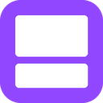
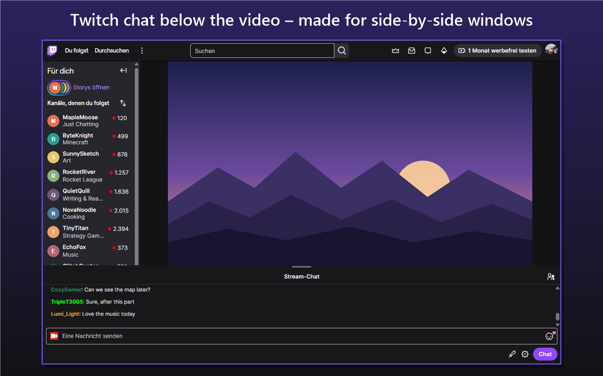
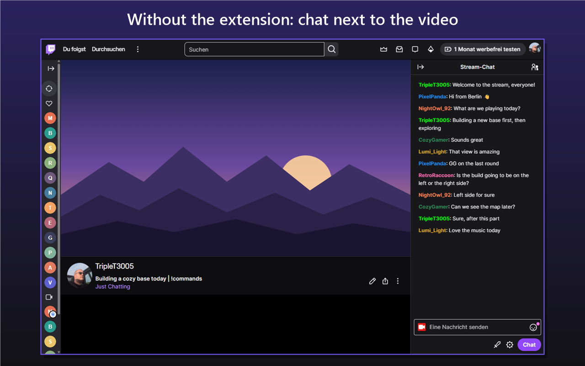
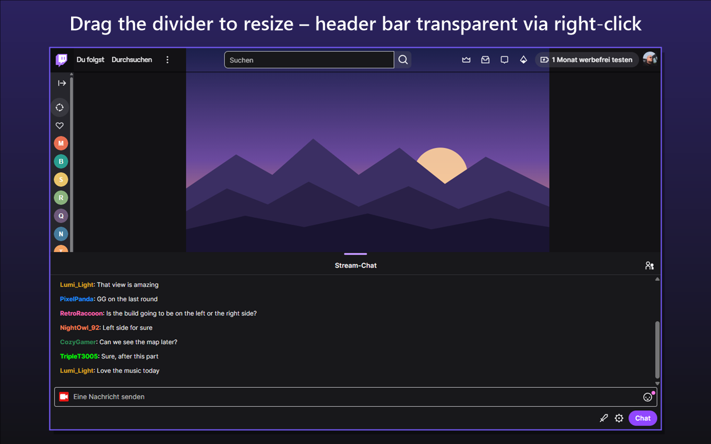
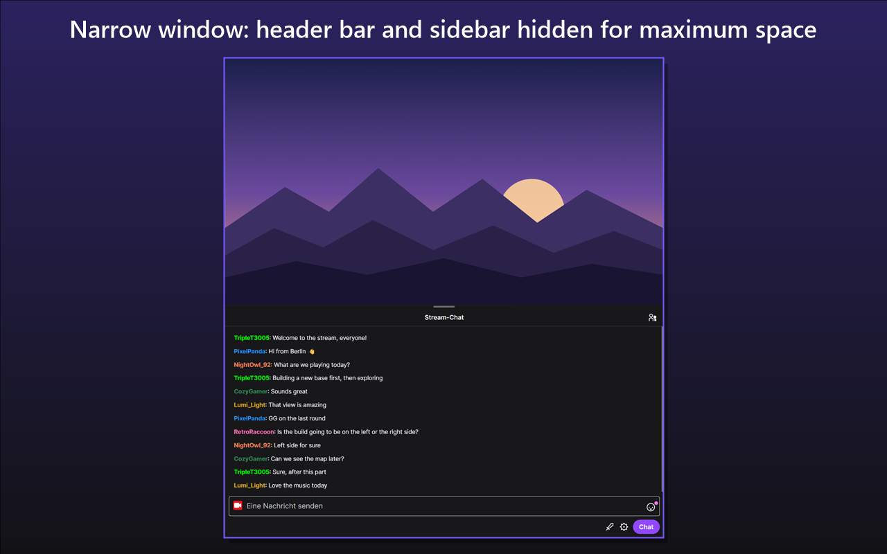
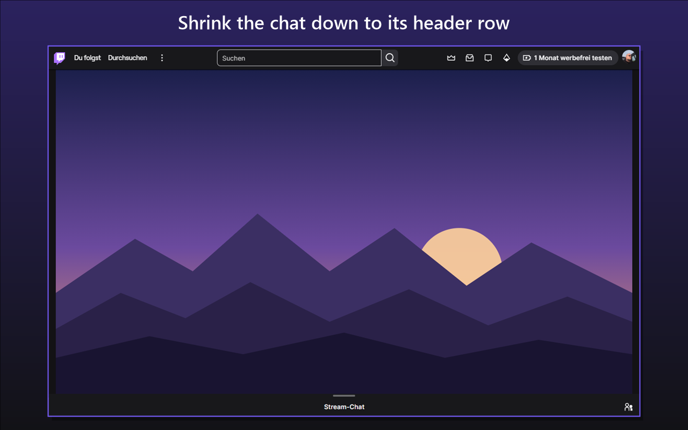

#  Chat Below for Twitch

<!-- web:skip -->
[English](#english) · [Deutsch](#deutsch) · [Screenshots](#screenshots)
<!-- /web:skip -->

## English

Browser extension for Chrome and Edge that moves the Twitch chat below the video with one click.
Useful when the monitor is split into two or three windows side by side.
Website: https://ckass.de/chat-below-for-twitch/

> Not affiliated with or endorsed by Twitch. Twitch is a trademark of Twitch Interactive, Inc.

### Features
- Toggle via the chat button in the video's control bar (next to settings and fullscreen) or via the extension icon in the browser toolbar
- Optional keyboard shortcut, configurable at `chrome://extensions/shortcuts` (Edge: `edge://extensions/shortcuts`)
- The video uses the full window width, the chat fills the space below it (at least 150 px)
- A running hype train is shown compactly in the chat header row
- Right-click the extension icon to hide the header bar or make it transparent, and to hide the left sidebar (applies while the chat is below the video)
- Drag the line between video and chat to change the split, down to just the chat header; double-click resets it
- Only active on stream pages; theatre mode and fullscreen keep working
- The setting is remembered for all Twitch tabs; with browser sync enabled it also applies on your other computers
- Available in English and German, depending on the browser language

### Privacy
The extension only changes how Twitch stream pages are laid out. It does not collect, read or send any personal data, has no access to your Twitch account and makes no external requests.

Your settings (chat below on/off, divider position, header bar and sidebar options) are stored with the browser's own storage. With browser sync enabled, your browser syncs them across your devices; the extension itself does not transmit them anywhere.

Permissions: `storage` to remember the settings, `contextMenus` for the right-click menu of the icon and access to `www.twitch.tv` to change the page layout.

### Install
- **Chrome:** [Chrome Web Store](https://chromewebstore.google.com/detail/chat-below-for-twitch/jfdcnglmpjdiofdlapohkchhhmkjffog)
- **Edge:** Edge Add-ons (coming soon)

Manual install from ZIP:
1. Download the latest ZIP from [Releases](../../releases) and extract it
2. Open `chrome://extensions` (Edge: `edge://extensions`)
3. Enable "Developer mode"
4. Click "Load unpacked" and select the extracted folder

<!-- web:skip -->

### Building
The extension needs no build step; the release ZIP contains `manifest.json`, `background.js`, `content.js`, `content.css`, `icons`, `_locales` and `LICENSE`. Run the tests with `node --test`.

A release is created automatically when a new version in `manifest.json` reaches `main`. Each version needs a section with English and German notes in [CHANGELOG.md](CHANGELOG.md), which becomes the release notes; tests and pipeline fail without it. Changes without a new version are collected under `[Unreleased]`; a release fails while that section still has entries.

<!-- /web:skip -->

### License
[MIT](LICENSE)

## Deutsch

Browser-Erweiterung für Chrome und Edge, die den Twitch-Chat per Klick unter das Video verschiebt.
Praktisch, wenn der Monitor in zwei oder drei Fenster nebeneinander aufgeteilt ist.
Website: https://ckass.de/chat-below-for-twitch/

> Nicht mit Twitch verbunden und nicht von Twitch unterstützt. Twitch ist eine Marke von Twitch Interactive, Inc.

### Funktionen
- Umschalten über den Chat-Button in der Steuerleiste des Videos (neben Einstellungen und Vollbild) oder über das Erweiterungssymbol oben in der Browserleiste
- Optionales Tastenkürzel, einstellbar unter `chrome://extensions/shortcuts` (Edge: `edge://extensions/shortcuts`)
- Das Video nutzt die volle Fensterbreite, der Chat füllt den Platz darunter (mindestens 150 px)
- Ein laufender Hypetrain wird kompakt in der Kopfzeile des Chats angezeigt
- Per Rechtsklick auf das Erweiterungssymbol lässt sich die Kopfleiste ausblenden oder transparent schalten und die linke Seitenleiste ausblenden (gilt, solange der Chat unter dem Video ist)
- Die Linie zwischen Video und Chat lässt sich ziehen, um die Aufteilung zu ändern, bis nur noch die Chat-Kopfzeile sichtbar ist; Doppelklick setzt sie zurück
- Nur auf Stream-Seiten aktiv; Kino-Modus und Vollbild funktionieren weiterhin
- Die Einstellung gilt für alle Twitch-Tabs; mit aktivierter Browser-Synchronisierung auch auf deinen anderen Computern
- Auf Deutsch und Englisch verfügbar, abhängig von der Sprache des Browsers

### Datenschutz
Die Erweiterung ändert nur die Anordnung von Twitch-Stream-Seiten. Sie erhebt, liest und sendet keine personenbezogenen Daten, hat keinen Zugriff auf dein Twitch-Konto und stellt keine externen Anfragen.

Deine Einstellungen (Chat unten an/aus, Position der Trennlinie, Optionen für Kopf- und Seitenleiste) werden im Speicher des Browsers abgelegt. Ist die Browser-Synchronisierung aktiv, gleicht dein Browser sie zwischen deinen Geräten ab; die Erweiterung selbst überträgt sie nirgendwohin.

Berechtigungen: `storage`, um die Einstellungen zu speichern, `contextMenus` für das Rechtsklick-Menü des Symbols und Zugriff auf `www.twitch.tv`, um die Anordnung der Seite zu ändern.

### Installation
- **Chrome:** [Chrome Web Store](https://chromewebstore.google.com/detail/chat-below-for-twitch/jfdcnglmpjdiofdlapohkchhhmkjffog)
- **Edge:** Edge Add-ons (bald verfügbar)

Manuelle Installation aus der ZIP-Datei:
1. Die neueste ZIP-Datei unter [Releases](../../releases) herunterladen und entpacken
2. `chrome://extensions` öffnen (Edge: `edge://extensions`)
3. „Entwicklermodus“ aktivieren
4. „Entpackte Erweiterung laden“ und den entpackten Ordner auswählen

<!-- web:skip -->

### Bauen
Die Erweiterung braucht keinen Build-Schritt; die Release-ZIP enthält `manifest.json`, `background.js`, `content.js`, `content.css`, `icons`, `_locales` und `LICENSE`. Die Tests laufen mit `node --test`.

Ein Release entsteht automatisch, sobald eine neue Version in `manifest.json` auf `main` landet. Jede Version braucht einen Abschnitt mit englischen und deutschen Notizen in [CHANGELOG.md](CHANGELOG.md), der zu den Release-Notizen wird; ohne ihn schlagen Tests und Pipeline fehl. Änderungen ohne neue Version stehen unter `[Unreleased]`; ein Release schlägt fehl, solange dieser Abschnitt noch Einträge hat.

<!-- /web:skip -->

### Lizenz
[MIT](LICENSE)

## Screenshots

